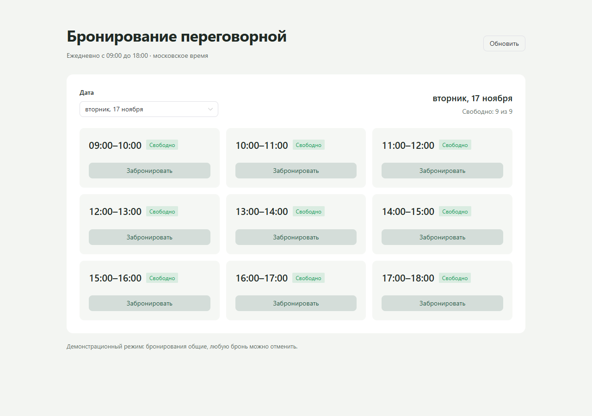

# Mini Booking

Бронирование одной переговорной: Laravel 13, PHP 8.4+, SQLite, Vue 3 (Composition API и script setup), Vite и Naive UI.

Код и документация подготовлены с помощью генеративного ИИ. Описание выполненных проверок и их ограничений: [quality/README.md](quality/README.md).



## Запуск на подготовленной Windows-машине

Запустите `START.cmd` и откройте http://127.0.0.1:5177 . Оба сервера работают в фоне. Для остановки используйте `STOP.cmd`.
Альтернатива: `BACKEND.cmd` и `FRONTEND.cmd` в двух терминалах, остановка через Ctrl+C.

## Установка из чистого клона

Нужны PHP 8.4+ с расширениями Laravel, PDO SQLite/sqlite3, Composer 2, Node.js 22.12+ и npm. Проверенные версии: PHP 8.4.27, Composer 2.11.2, Node 22.23.2, Laravel 13.42.0, Vue 3.5.45, Naive UI 2.45.3. Lock-файлы включены в репозиторий.

В папке `backend` выполните:

```sh
composer install
```

Скопируйте `.env.example` в `.env` и создайте пустой файл `database/database.sqlite`. Например, для нового клона в PowerShell:

```powershell
Copy-Item .env.example .env
New-Item database/database.sqlite -ItemType File
```

Эти команды выполняются один раз. Существующие настройки и рабочую базу не перезаписывайте.

```sh
php artisan key:generate
php artisan migrate --seed
php artisan serve --host=127.0.0.1 --port=8017 --no-reload
```

Во втором терминале, в папке `frontend`:

```sh
npm ci
npm run dev
```

Откройте http://127.0.0.1:5177 . Vite передаёт запросы `/api` на Laravel, порт 8017.

На подготовленной Windows-машине из папки backend вместо `php` можно использовать `..\.tools\php\php.exe`, вместо `composer` — `..\.tools\php\php.exe ..\.tools\composer.phar`.
Переносные PHP и Composer не входят в Git. Повторная подготовка на Windows: `python scripts/setup-tools.py` из корня проекта. Нужен интернет; скрипт проверяет официальные контрольные суммы PHP и установщика Composer.

Основные настройки `.env`:

```dotenv
DB_CONNECTION=sqlite
APP_TIMEZONE=Europe/Moscow
APP_URL=http://127.0.0.1:8017
FRONTEND_URL=http://127.0.0.1:5177
APP_DEBUG=false
```

При смене адресов нужно согласованно изменить Vite proxy, CORS и Host allowlist. Оба сервера привязаны только к 127.0.0.1. Это локальное демо, не публичный сервис.

## Расписание и время

`php artisan db:seed` создаёт расписание на сегодня и следующие шесть календарных дней: по девять часовых слотов с 09:00 до 18:00, включая выходные. Прошедшие часы сегодняшнего дня также создаются. Повторный запуск не меняет существующие слоты и бронирования; на следующий день добавляются девять недостающих слотов, старые сохраняются. Автоматического продления через cron нет.

Начало и конец хранятся как Unix seconds UTC. Seeder вычисляет даты и часы в `config('app.timezone')`. API возвращает ISO 8601 со смещением, `timezone` и `server_now`. Frontend форматирует даты через Intl в часовом поясе расписания, а не устройства. Между загрузками серверные часы продолжаются через performance.now. Окончательное решение принимает backend: начало слота, равное текущему времени или более раннее, считается прошедшим.

## API

Используйте `Accept: application/json`, для POST также `Content-Type: application/json`.

| Метод | Ответ |
| --- | --- |
| GET /api/slots | 200: `{data:[{id,starts_at,ends_at,status,booking_id}],timezone,server_now}`. Сортировка по началу, имя и email не включаются |
| POST /api/bookings | Тело: `{slot_id,customer_name,customer_email}`. Успех: 201 `{id}`. Неверные поля или несуществующий слот: 422 `{message,errors}`. Занятый или прошедший слот: 409 `{message}` |
| DELETE /api/bookings/{id} | 204. Повторная отмена также возвращает 204 |
| GET /api/health | Техническая проверка API и SQLite |

Дополнительные ответы: чужие Host/Origin — 403; тело больше 8 KiB — 413; POST без JSON — 415; временная занятость базы — 503 с Retry-After: 1. Отладочные стеки не выдаются.

## Гарантия единственного бронирования

`bookings.slot_id` имеет UNIQUE и внешний ключ. Одна строка — одна активная бронь. Отмена физически удаляет запись, освобождая ключ; история отмен не сохраняется.

Создание выполняется в `DB::transaction`. SQLite настроена на IMMEDIATE и busy_timeout 5000: writer lock получается до чтения слота и проверки времени. В установленном Laravel этот режим применяется на PHP 8.4+, поэтому PHP 8.4 — минимальная версия проекта. Ограничение UNIQUE остаётся окончательной гарантией базы. Перехватывается конкретный UniqueConstraintViolationException и возвращается 409; произвольная ошибка базы не выдаётся за занятость слота. Исчерпание ожидания блокировки даёт 503.

## Проверки

В папке `backend`:

```sh
php artisan test
```

Два обязательных теста в `tests/Feature/BookingTest.php`:

- `test_free_future_slot_can_be_booked`;
- `test_second_request_for_booked_slot_conflicts_without_second_booking`.

Также проверяются валидация, граница текущего времени, отмена и повторная бронь, сортировка и отсутствие личных полей, повторный Seeder и смена дня, Host/Origin, размер и тип запроса. PHPUnit использует отдельную in-memory SQLite.

В папке `frontend`: `npm run build`.

Из корня: `python quality/race-check.py` — три раунда по четыре независимых PHP-процесса. Проба использует новую базу в `.runtime`, не рабочую. Результат с контрольными суммами: `quality/race-result.json`. Скрипт рассчитан на подготовленную Windows-машину с `.tools/php/php.exe`.

## Интерфейс и ограничения

Есть фильтр даты, три статуса слотов, форма с проверкой имени/email, подтверждение отмены, загрузка и блокировка повторных действий. Ошибки 422 видны у полей; при 409 расписание обновляется. При сетевой или серверной ошибке можно повторить действие. После успешного запроса список обновляется без перезагрузки. Если запись сохранилась, но обновление списка не удалось, показаны отдельно подтверждение записи и ошибка списка; новые действия блокируются до успешной загрузки.

Авторизация, управление комнатами, админка и Scheduler не входят в задание. В демо любую бронь можно отменить по известному ID — это намеренное ограничение, не защита реального офиса. Используются только вымышленные данные. Внешних интеграций и телеметрии нет.

В Git не входят `.env`, SQLite, `.tools`, `.runtime`, vendor и node_modules. Личные рабочие материалы (`review/`) также исключены из Git.

Время подготовки и реализации: [TIME-LOG.md](TIME-LOG.md). Сценарии, результаты и ограничения проверок: [quality/README.md](quality/README.md).

Откат: остановить серверы через STOP.cmd, сохранить копию SQLite и при необходимости выполнить `php artisan migrate:rollback --step=1`. Откат удалит таблицы bookings и slots; без копии данные будут потеряны.
